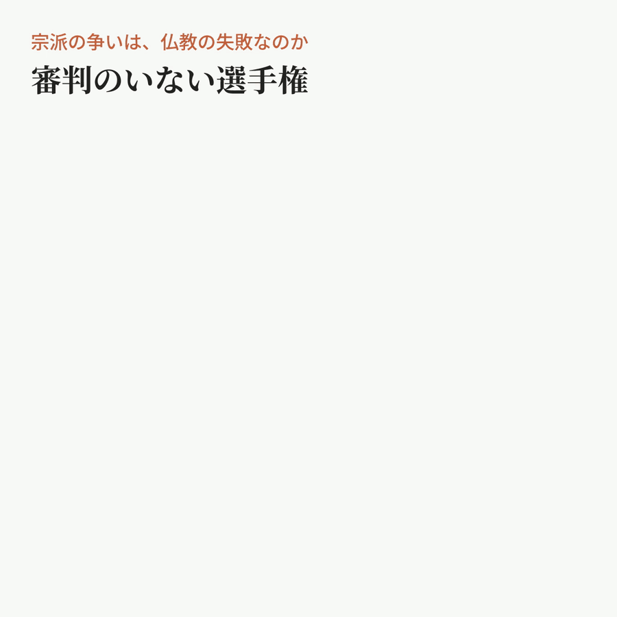
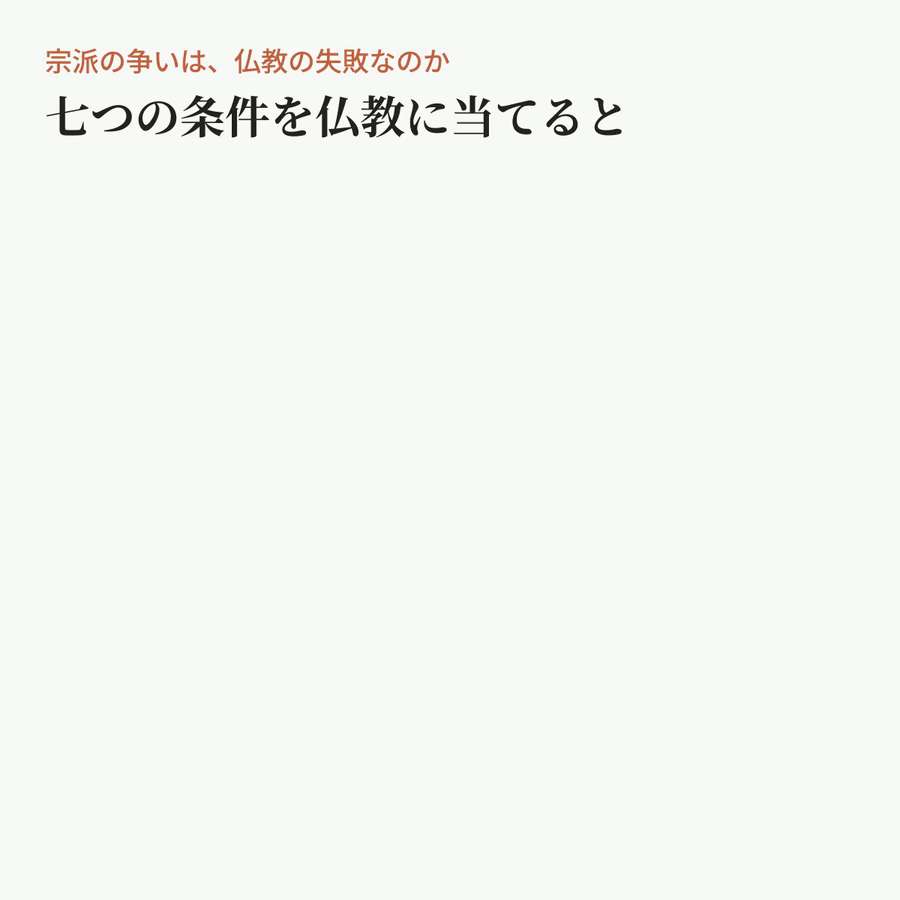
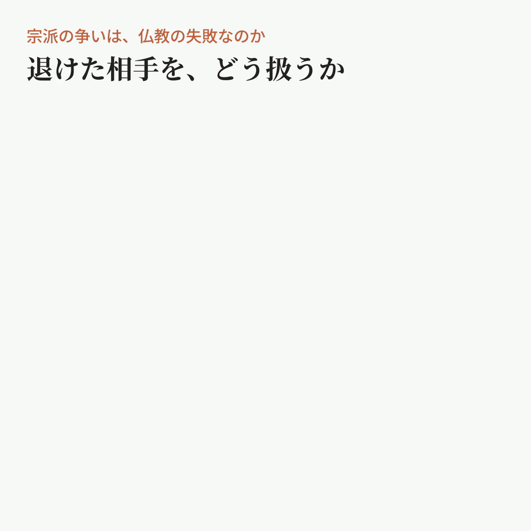

# 宗派の争いは、仏教の失敗なのか

*ギャリーの「本質的に論争的な概念」を、分裂の歴史と方便に当ててみる*

## 同じ教えから、なぜこれほど分かれたのか

日本で暮らしていると、宗派の名前には葬儀や法事で出会います。浄土真宗、曹洞宗、日蓮宗、真言宗。もとをたどれば一人のブッダの教えのはずなのに、唱える言葉も、頼りにする経典も、坐るのか称えるのかも違います。

この多さには、よく二つの説明が与えられます。一つは「どれかが正しく、ほかは途中で逸れた」。もう一つは「登り口が違うだけで、どれも同じ山頂に通じている」。前者は争いを、勝者が決まるまでの過渡期と見ます。後者は争いを、見かけだけのものと見ます。どちらの説明でも、争いそのものには居場所がありません。

哲学には第三の見方があります。ある種の概念は、正しく使おうとすること自体のなかに、使い方をめぐる終わらない争いを含んでいる。争いは事故でも誤解でもなく、その概念の働き方の一部だ、という見方です。1956年にこの考えを出した哲学者 W. B. ギャリーは、こういう概念を「本質的に論争的な概念」と呼びました。

仏教の「法」、つまりブッダの教えがこれに当たるとすると、何が変わるのでしょうか。変わることは二つあります。

一つは、宗派の争いが失敗ではなくなることです。どれが正しい法かという争いは、教えが壊れた結果でも、言葉の行き違いでもなく、「法」という語が正しく使われているときの姿だ、ということになります。

もう一つは、その代わりに、どの宗派も自分の正しさを決着させられなくなることです。「これこそが法だ」という主張は、どの側も理由を挙げて続けることができます。けれども、全員が受け入れるほかない形でそれを一つに決める手続きは、原理的にないことになります。

これは「真理は一つではない」という主張とは違います。ギャリーが論じているのは概念の使い方で、世界がどうあるかではありません。法という真理が一つあるとしても、誰の「これが法だ」がそれを言い当てているのかは決着しない、という話です。それでも仏教の側から見れば、十分に重い話です。どの伝統も、自分たちの教えこそがその一つの真理を伝えていると言ってきたからです。実際、ギャリーの枠組みには、結局は相対主義に行き着くという批判が向けられてきました。

ギャリーは、いちばんよく当てはまる例として「キリスト教徒として生きること」を挙げました。そのうえで、七つある条件のうち一つだけは疑わしいと書いています。争いは歴史上ずっと続いてきたが、それは本当に避けがたいものなのか、という疑いでした。

仏教に当てると、引っかかる場所が変わりそうです。仏教には、僧団を割ることを最も重い罪の一つに数える伝統があります。古い経典には、見解をつかんで争うこと自体を苦しみの側に置く言葉もあります。争いを概念の働き方の一部として認める枠組みは、こういう教えにどこまで当てはまるのでしょうか。当てはまりにくいとすれば、七つの条件のどこでしょうか。

この文章は、ギャリーの枠組みを仏教の宗派の分裂と、法華経の方便（ほうべん）に当ててみた記録です。書き始める前に、いくつかの見立てを置きました。条件のうち二つは仏教にとくによく当てはまりそうだ、三つの点でぶつかりそうだ、方便は二つの層に分けて読めそうだ、というものです。以下ではそれを前提にせず、確かめる対象として扱います。結論を一つに絞ることは目指していません。当てはまるところ、ぶつかるところ、読み方で割れるところを分けて並べます。どの宗派の立場が正しいかは判定しません。

書き方の約束が二つあります。文や段落の終わりに（資料）とあれば、そこまでは文献が言っていることです。（当てはめ）とあれば、それをギャリーの条件に引き当てたこの文章の読みで、文献の主張ではありません。また、資料をどこまで確かめたか（本文を読んだのか、抄録までなのか）は、末尾の一覧に分けて書きました。

## 前提1　ギャリーの「本質的に論争的な概念」

ギャリーの論文「本質的に論争的な概念」は、1956年3月にアリストテレス協会で読み上げられ、同協会の紀要56巻（167〜198頁）に載りました。以下の頁はこの紀要のものです。

彼は架空の選手権から話を始めます（170〜171頁）。この選手権では、勝敗が得点ではなく、プレーの流儀の見事さで決まります。チームごとに得意な流儀が違い、公式の審判はいません。各チームには支持者がいて、自分たちのチームこそ「チャンピオン」だと言います。ほかのチームの支持者も同じことを言います。そのときどきで支持者のいちばん多いチームが事実上のチャンピオンとして扱われることはあっても、それは流儀の優劣についての合意ではありません。支持者たちはでたらめを言っているわけではなく、それぞれ理由を挙げて言い合いを続けます。

この例から取り出されるのが、次の定義です。その正しい使い方が、使い手どうしの間に、正しい使い方をめぐる終わりのない争いを避けがたく含んでいる概念（169頁）。意味の違いが明らかになっても、どの側も自分の言い分を守りつづけます（168頁）。

ギャリーは条件を七つ挙げます。

1. ほめる語である。価値ある達成を指し、それを認めるために使われる（171頁）
2. その達成は内側が込み入っていて、価値は全体に対して与えられる（171〜172頁）
3. 部分のどれを重く見るかで、いくつもの描き方が成り立つ。どの描き方も、前もって不合理とは言えない（172頁）
4. 達成は状況の変化に応じて形を変え、その変わり方は前もって定めることも予測することもできない。ギャリーはこれを「開いている」と呼ぶ（172頁）
5. どの側も、自分の使い方がほかの側から争われていることを知り、相手の基準をいくらかは分かっている。語は攻めにも守りにも使われる（172頁）
6. その概念は、争うすべての側が権威を認める、もとの手本から来ている（180頁）
7. 競い合いが続くことで、手本の達成がいちばんよい形で保たれ、育てられると、もっともらしく言える（180頁）

条件6と7は、ある反論に答えるために足されました。それは「一つの語が二つの別の概念を覆っているだけの、ただの混乱ではないのか」という反論です（175〜176頁）。条件1から5だけでは、本質的に論争的な概念と、根本から混乱した概念とを区別できない、とギャリー自身が認めています（180頁）。同じ手本から来ていること、そして競い合いに意味があること。この二つが、争いを続けてよい理由になります。

条件7の擁護には、強い限定が付いています。競い合いがなければ手本の達成はここまで保たれなかっただろう、という主張は「極めて条件つき」のもので、一つの可能性として出されているにすぎず、場合によっては事実がただちにそれを退けます。競い合いが貧しさや荒れた政治的分断に行き着くなら、私たちの受け止め方は大きく変わるだろう、とギャリーは書いています（178〜179頁）。

実例として挙げられるのは、芸術、民主主義、社会正義、そしてある宗教を信じて生きることの四つです。ギャリーは四つ目が条件をいちばんよく満たすと述べ、「キリスト教徒として生きること」で説明します（180頁）。条件6への適合は明らかだとし、条件7は多くの限定つきで認められるだろうとします。そして、いちばん疑わしいのは条件5だと書きます（181頁）。歴史を見ると、一つの支配的な教会があり、たいていはそれに異を唱える諸派がある、という形が続いてきました。けれどもこの形は、概念の性質から必ず出てくるものなのでしょうか。ほかの条件は、争いが続くことまでは含んでいません。ギャリーはそう問い、それでも争いが続く見込みは極めて高い、と補っています。

論文の後半に、この文章でとくに使いたい区別があります（192〜194頁）。相手がいると知ることと、争いが自分の営みの本質に属すると認めることは違う、という区別です。前者は低い段で、日々の攻めと守りの使い方に当たります。後者は高い段で、ここでは退けた使い方を、自分の使い方への恒常的な批判の材料として認めることになります（193頁）。ギャリーはここから、論拠の質が目に見えて上がることを期待しました。同時に暗い側も書いています。相手を説得できるという望みが消えると、異端を断罪し、要らない者を根絶する方へ転ぶかもしれません（193〜194頁）。ただし彼はこれを、起こりうる因果的な結果であって、論理的な帰結ではないとしています（194頁）。この文章では、高い段の認識を「二階の認識」と呼びます。

この枠組みには批判もあります。コリアーらの総説（2006年）の整理では、相対主義に陥るという批判（グレイ）、手本があるという想定そのものへの疑い（ゲルナー、フリーデン）、条件5は実際の担い手に欠けやすく、相手を意識せずに別の意味で使っているだけの場合があるという批判（フリーデン）、条件7に対して、争いはむしろ概念を貧しくしうるという批判（フリーデン）などが並んでいます。総説の著者たち自身は、この枠組みを仮説としてではなく、分析の道具立てとして使うことを勧めています。この文章もその使い方に従います。

この枠組みを仏教に当てた研究として確かめられたのは、クラウゼの2024年の論文一本です。「エンゲージド・ブッディズム」と「人間仏教」という二つの近代の概念を、ギャリーの意味で本質的に論争的な概念と見なせるとし、中国語圏での受容を排他主義、包摂主義、実用主義の軸で整理しています。確かめられたのは抄録までで、七つの条件を一つずつ当てているのか、宗派の分裂や方便に触れているのかは分かっていません。部派や宗派の分裂、方便、経典の順位づけにギャリーの枠組みを当てた研究は、今回探した範囲では見つかりませんでした。探したのは英語、日本語、中国語のウェブ検索で、論文データベースを直接引いたわけではありません。ないと言えるところまでは確かめていません。

もう一つ、宗教を本質的に論争的な概念として扱う議論のなかで、コルテス（2013年）は、論争の歴史があるというだけでは本質的に論争的な概念にはならない、と注意しています（要旨の水準で確認）。仏教に宗派の争いの歴史があることは、それだけでは何も示しません。以下で条件6と7に紙幅を割くのは、そのためです。

## 前提2　仏教の側の、最小限の見取り図

仏教の側で押さえておきたいことは五つです。

一つ目。ブッダは後継者を指名しなかったと伝えられています。パーリ語で伝わる経典の『大般涅槃経』（長部16経）でブッダは、自分が説き示した法と律（りつ、出家者の生活の決まり）が、自分の亡きあとの師であると言います。別の経（中部108経）では、弟子のアーナンダが、ブッダに指名された出家者も、僧団が選んだ出家者もいないと答え、「法が私たちのよりどころです」と言います。

二つ目。ブッダの死後、僧団はいくつもの部派（ぶは）に分かれました。伝統的には十八部と数えられます。最初の分かれ目は、上座（じょうざ）と大衆部（だいしゅぶ）の二つへの分裂とされ、根本分裂と呼ばれます。その後の部派は、この二つのどちらかの流れに属します。説一切有部（せついっさいうぶ。以下、有部）や経量部（きょうりょうぶ）も、いまスリランカや東南アジアに伝わる上座部（テーラワーダ）も、上座の側から出た部派です。各部派は、教えを要素に分けて整理する学問を発達させました。これがアビダルマで、その要素のことも「法」（ダルマ）と呼びます。

三つ目。大乗仏教は、部派がもう一つ増えたものではありません。大乗は部派をまたいで広がった動きで、大乗を受け入れた出家者も、どこかの部派の律で出家していた、という見方が研究では広く取られています（ベッヒェルトの議論。別の研究者の引用を通じて確認）。中観（ちゅうがん）と唯識（ゆいしき）は、その大乗の内側の二大学派です。

四つ目。中国と日本では、どの経典や論書をよりどころにするかで「宗」が立ちました。その際、数多い経典を整理して順位づける作業が発達しました。これを教相判釈（きょうそうはんじゃく）、略して教判と呼びます。

五つ目。方便は、相手と場に合わせた教えの手立てを指す語です。日常語の「嘘も方便」とは違い、仏教の文脈では、聞く者を導くために設けられた仮の教えを言います。法華経はこの語を、それまでの教え全体の位置づけに使いました。

## 何が争われているのか

ギャリーの例では、争われているのは「チャンピオン」や「キリスト教徒らしい生き方」という、ほめる語でした。仏教でこれに当たる語は何でしょうか。

パーリ語の律のうち、僧団の分裂を扱う章（破僧犍度〔はそうけんど〕、小品第7章）は、僧団を割る者がどう言うかを定型で記しています。「これが法である、これが律である、これが師の教えである。これを取りなさい、これをよしとしなさい」（資料）。

争われているのは、この「これが法である」という言い方だと読みます。ここでの「法」は、アビダルマで言う要素としての法ではなく、ブッダの教え、あるいは教えが示す真実を指す法です。「法」「仏説」「正法」は、ある教えや実践がブッダの教えにかなっていると認める語で、どの側もそれを自分の側に使います。以下では、この語の使い方に七つの条件を当てていきます（当てはめ）。

**割れる**　そもそも最初の分裂は、教えの中身をめぐる争いだったのでしょうか。カズンズの整理では、根本分裂の原因についての伝承は二つに分かれます。有部系の資料は、大天（だいてん）という人物の「五事」、つまり阿羅漢（あらかん、修行を完成した聖者）の完全さを疑う五つの主張をめぐる教義上の争いを原因とします。テーラワーダ系と大衆部系の資料は、律をめぐる争いを原因とします。現代の研究も割れています。ナティアとプレビッシュは、律の拡張をめぐる分裂が先で、五事はその後の大衆部の内側の分裂に属すると論じたとされます。カズンズは、大天の名が紀元5世紀より前の資料に出ないこと、五事がのちに触れる『論事』の論点と同じ構造を持つことから、五事を根本分裂の原因と見ません（資料）。五事を主因と見る研究もあるようですが、今回は中身を確かめていません。

書き始める前の見立てでは、律の十項目をめぐる争い（十事）と大天の五事とで伝承が割れている、と置いていました。カズンズによれば、スリランカの史書は、教えと律を確かめ直す二度目の集会（第二結集）で退けられた側から分裂が始まったと伝え、教義上の原因には触れません（資料）。十事そのものを根本分裂の原因として明記しているかどうかは、今回確かめられませんでした。

原因が律だったなら、争いは「ほめる語の使い方」よりも「決まりの文言」をめぐるものに近く、ギャリーの枠組みから外れるように見えます。ただ、破僧犍度が分裂のもとになる事柄として挙げる十八項目には、律であるかないか、罪であるかないかも含まれていて、決まりをめぐる争いも「これが律である、これが師の教えである」という同じ言い方で争われます。枠組みの外と読むか内と読むかは割れます（当てはめ）。

## 七つの条件を一つずつ当てる

### 条件1　ほめる語である

**当てはまる**　「仏説である」「正法である」は、価値ある達成を認める語として働いています（当てはめ）。

**ぶつかる**　争いの当事者は、ほめ方を競っているつもりではありません。アッタカヴァッガ（パーリ語の古い詩集『スッタニパータ』の第4章）は、論争する人々の言い方を「これだけが真実だ」と写しています（スッタニパータ 4.13 第1偈）（資料）。当事者にとって、法は達成をほめる語である前に、事実がどうであるかを言う語です（当てはめ）。

**割れる**　同じアッタカヴァッガの別の経は、「真実は一つであり、第二のものはない」と言ったうえで、論争する人々はめいめい別々の真実を自分で称えている、と続けます（スッタニパータ 4.12 第7偈）（資料）。経の側から見ると、当事者の「これが真実だ」は、自分の見解をほめる働きをしています。当事者の位置から読めば条件1にぶつかり、経の位置から読めば条件1に当てはまります（当てはめ）。総説によれば、コノリーは評価的な語が記述的でもあることを指摘しています（資料）。

### 条件2　内側が込み入っていて、価値は全体に付く

**当てはまる**　仏教の実践は、戒・定・慧の三学や八正道のように、はじめから複数の部分の組として語られます（当てはめ）。

**ぶつかる**　日本の鎌倉期には、阿弥陀仏の名を称える念仏、ひたすら坐る坐禅、法華経の題目を唱える唱題のように、一つの行を選び取ってほかを脇に置く立場が現れました。ここでは価値が全体ではなく一つの部分に置かれているように見えます（当てはめ）。

**割れる**　これを条件2に反すると読むか、条件3の「重みづけ」が極端になった形と読むかで割れます（当てはめ）。

### 条件3　部分の重みづけで、いくつもの描き方が成り立つ

**当てはまる**　戒律を重く見る、教えの分析を重く見る、空（くう、あらゆるものに固定した実体がないこと）を重く見る、識（しき、心の働き）を重く見る、信を重く見る。宗派の違いの多くは、この重みづけの違いとして描けます（当てはめ）。

私は attention-not-self という研究リポジトリを GitHub で公開していて、そこに三つのアビダルマの体系を並べた対照表を置いています。この表は、描き方が複数成り立つことの一つの実物です。たとえば「見」（けん、誤った見解）は、テーラワーダと唯識では独立した心の働きとして数えられ、有部では慧（え、見きわめる働き）の一つのあり方とされます。全体の数え方も違い、有部は75、テーラワーダは82、唯識は100の要素を立てます（対照表による）。

**ぶつかる**　条件3は、どの描き方も前もって不合理とは言えない、と求めます。しかし当事者は、相手の描き方を「成り立ちうる別の描き方」として扱わず、不完全な教えや誤りとして扱うことがよくあります（当てはめ）。

**割れる**　外から歴史を見る者には複数の描き方が並んで見え、内側にいる者には一つの正しい描き方とその手前の段階が見えます。どちらの位置から読むかで割れます（当てはめ）。

### 条件4　開いている

**当てはまる**　ブッダの死後に大乗経典が現れ、中国で教判が発達し、日本で一つの行を選び取る宗派が生まれました。どの変化も、前の時代から予測できたとは言いにくいものです。七つのうちで、いちばん素直に当てはまる条件だと思います（当てはめ）。

**ぶつかる**　当事者は変化を変化として語りません。法華経の方便品は、諸仏がこの世に現れる理由はただ一つの大きな目的のためだと述べます（大正蔵9巻7頁上）（資料）。新しい教えは、はじめからあった本意の開示として示されます（当てはめ）。

**割れる**　経典の範囲を閉じたものと見るか、開いたものと見るかは、伝統によって違います（当てはめ）。

### 条件5　相手に争われていると知り、相手の基準をいくらか分かっている

仏教には、相手の説を並べて論じる文献の型が早くからあります。テーラワーダの『論事』（ろんじ、カターヴァットゥ）は、他の立場を一つずつ取り上げて論駁する形式の論書です。標準的な概説によれば、ヴァスバンドゥ（世親）の『倶舎論』（くしゃろん）は、本文の偈で有部の説をまとめ、自分で付けた注のなかで経量部寄りの立場から批判を加えます。これに対して衆賢（しゅげん）が『順正理論』で有部の側から反論しました。チベットには、有部（毘婆沙師）、経量部、唯識、中観の四つの学説を順に学ぶ宗義書の伝統があります（資料）。

**当てはまる**　相手の基準を知ったうえで自説を守る、という条件5の姿は、これらの文献にはっきり見えます。書き始める前の見立てでは、条件5はキリスト教より強く当てはまるかもしれない、と置いていました。ギャリーが条件5を疑うときに挙げたのは、支配的な一つの教会と、それに異を唱える諸派という形でした。前提2で見たとおり、経典はブッダが後継者を指名せず、法と律を師としたと伝えます。全体を束ねて正統を裁く役は、はじめに置かれませんでした。出発点の形は、公式の審判のいないギャリーの選手権に近いと言えます（当てはめ）。

ただし、これで言えるのは、ギャリーが疑いの根拠にした形が仏教には見当たりにくい、というところまでです。裁く役がいなければ争いは起こりやすくなりますが、それは歴史上の事情です。争いが概念の性質から必ず出てくるのか、というギャリーの問いそのものには、仏教の例も答えていません（当てはめ）。

**ぶつかる**　カズンズは、『論事』に出てくる「部派の説」の多くが、論点を鋭くするために組み立てられた難題だと論じています。論敵の部派名は本文になく、後の注釈が付けたものです。また、大乗経典が「小乗」と呼んで退ける相手は、実在の集団というより修辞上の相手だという議論もあります（シルク。要約の水準で確認）（資料）。そうだとすると、知っていた「相手」は、自分で組み立てた相手だったことになります。相手を意識せず別の意味で使っているだけ、というフリーデンの批判とは逆向きですが、条件5が求める相互の認識が欠けている点では同じです（当てはめ）。

**割れる**　宗義書が四つの学説を並べるとき、下の三つは「いくらか分かっている相手の基準」なのでしょうか、「すでに越えた段」なのでしょうか。ホプキンスの紹介では、宗義は他派を論破するためというより、自分の誤った理解を崩すために学ばれます（要約の水準で確認）（資料）。これは条件5よりも、あとで見る二階の認識に近い話です（当てはめ）。

### 条件6　すべての側が権威を認める手本

**当てはまる**　どの宗派もブッダを手本とし、自分の教えを仏説として示します。ギャリーがキリスト教について「明らか」と言ったのと同じ意味で、当てはまります（当てはめ）。

**ぶつかる**　争いは、手本の解釈だけでなく、手本が誰であるかにも及びます。法華経の如来寿量品でブッダは、はるかな昔に成仏していたと明かし、人々を導くために方便として涅槃（死）を現すのであって、実際には滅していない、と語ります（「方便現涅槃　而実不滅度」、大正蔵9巻43頁中）（資料）。ここでは、八十歳で亡くなった歴史上のブッダという手本の姿そのものが、方便として読み替えられています（当てはめ）。

**割れる**　総説によれば、ギャリーの手本には、一つの原型を指す狭い読みと、似かよった複数の伝統を指す広い読みがあり、マッキンタイアやグレイは、手本そのものが込み入って開いているなら、全員が同じ権威を認めるとは考えにくいと批判しました（資料）。仏教は、全員が「ブッダ」という名の権威を認めながら、そのブッダが誰なのかで割れている例として読めます。これを条件6に当てはまると見るか、ぶつかると見るかは、狭い読みと広い読みのどちらを取るかで決まります（当てはめ）。

### 条件7　競い合いが、手本の達成を保ち育てる

**当てはまる**　カズンズは、『論事』の組み立てられた難題が、のちの中観の弁証法の遠い祖先に当たると述べています（資料）。

私のリポジトリの論考「滅尽定のあとに心はどう戻るのか」で扱った例も、ここに置けます。永続する自己がないのなら、何が瞬間と瞬間をつなぐのか。この一つの問いに、有部は得（とく）を、経量部は種子（しゅうじ）を、唯識は阿頼耶識（あらやしき）を、テーラワーダは有分（うぶん）を立てました。経量部は有部の得を余分な実体として嫌って種子を立て、唯識はその種子を蔵する深層の識として阿頼耶識を立てました。相手の答えへの不満が次の答えを生んだようにも読める並びです（当てはめ。記述は同論考による）。

書き始める前の見立てでは、「中観と唯識、有部と経量部の論争が互いの論証を鋭くした」と置いていました。この評価そのものを明言している研究は、今回の範囲では確かめられませんでした。上の二つは、その見立てを支える材料に留まります。

**ぶつかって見えるもの**　一つ目は破僧（はそう、僧団を割ること）です。パーリ語の経典（増支部5集129経）は、母を殺すこと、父を殺すこと、阿羅漢を殺すこと、悪意をもってブッダの身から血を出させること、僧団を割ることの五つを、地獄へ導く癒しがたい傷として挙げます。破僧犍度は、僧団を割った者は一劫（いっこう、途方もなく長い時間の単位）のあいだ地獄で煮られ、割れた僧団を和合させた者は一劫のあいだ天で喜ぶ、と述べます（資料）。

ただし、同じ章には細かい限定があります。破僧が成り立つのは、法でないものを法と言うなど十八の事柄にもとづいて分かれ、定期の集会や僧団の議決を別々に行ったときです。さらにブッダは、僧団を割る者がみな救いがたいわけではないと答えます。救いがたいのは、自分の見解を偽って「これが法である」と言い立てた者です。自分の言うことが法であり、分かれることも正しいと本当に見ていて、見解を偽らずに言った者は、救いがたい者には数えられていません（資料）。

するとこの律は、意見が割れることと、集会と議決を分けることを別のものとして扱っています。そのうえで最も重い罪を、不誠実な言い立てに置いています。ギャリーが条件7に付けた限定は、荒れた分断という結果の側に置かれていました。律の重さは、言い立てる者の誠実さの側に置かれています。軸は違います。それでも、教えをめぐって争うこと自体を罪にしていない点では重なります。破僧の重さは、条件7と正面からぶつかるものではなさそうです（当てはめ）。なお、ここで見たのはパーリ語の律だけで、ほかの部派の律の定義は確かめていません。

**ぶつかる**　深くぶつかるのは、見解をつかんで争うことへの批判です。アッタカヴァッガのある経では、人々が「ここにだけ清らかさがある」と言って集まりに乗り込み、互いを愚か者と見なし、称賛を求めて論じます。言い負かされれば嘆き、ほめられれば高ぶります。そして経は、論争には称賛を得ることのほかに目的がない、これは清らかさへの道ではない、と言います（スッタニパータ 4.8）。別の経は、論争の実りは非難と称賛の二つだけで、どちらも安らぎには足りない、と言います（同 4.13）（資料）。

アッタカヴァッガの外にも、同じ向きの経があります。中部74経では、ある見解に立つ者が、自分のなかに口論、論争、悩み、害の見込みを見て取り、その見解を捨て、別の見解もつかまない、と説かれます（資料）。

条件7は、競い合いには、担い手が得る称賛を越えた実りがあると言います。手本の達成が保たれ育つ、という実りです。これらの経は、論争の実りは称賛と非難のほかにないと言います。ぶつかっているのは、その「ほかの実り」があるかどうかです。しかもその否定は、外からの批判としてではなく、手本とされるブッダの言葉として伝わっています（当てはめ）。争いはむしろ概念を貧しくしうる、というフリーデンの批判と向きは同じですが、こちらは概念の貧しさよりも、争う人の苦しみを見ています（当てはめ）。

**割れる**　アッタカヴァッガの読み方が割れています。あらゆる見解を手放すことを説くと読む側（ゴメス）と、問題は見解を持つことにはなく見解へのしがみつきにあり、正しい見方はどの見解にも寄りかからない離れた見方として働くと読む側（フラー）があります（どちらも要約の水準で確認）（資料）。

ここで語を分けておきます。これまで「見解をつかむ」と書いてきました。前者の読みでは、「つかむ」は見解を持つことそのものです。後者の読みでは、「つかむ」は見解にしがみつくことで、持つこととは別です。後者の読みなら、しがみつかずに見解を持ち、論じることができれば、条件7は生き残ります。前者の読みなら、条件7の擁護そのものが、見解を持ちつづける一つの形になります（当てはめ）。

## いちばん当てはまりにくいのはどの条件か

七つを通して見ると、条件2、3、4、6は、ギャリーがキリスト教について認めたのと同じくらいには当てはまります。条件1と5は読む位置によって変わります。いちばん深くぶつかったのは条件7でした（当てはめ）。

ギャリーはキリスト教について、条件5をいちばん疑わしいとしました。争いは歴史上ずっと続いてきたが、それが概念の性質から必ず出るものかは分からない、という疑いでした。

仏教では、疑わしい場所がずれる、とこの文章は読みます。いちばん当てはまりにくいのは条件7です。理由は手本の側にあります。競い合いは手本の達成を保ち育てるはずでした。ところが、手本とされるブッダの言葉として伝わる経典の一部が、見解をつかんで競い合うことを、達成の反対側に置いています。キリスト教の例でギャリーが問うたのは「争いは避けがたいのか」でした。仏教の例で前に出てくるのは「争いは望ましいのか」という問いで、その問いは手本の内側から出てきます（当てはめ）。

別の読みも成り立ちます。条件6をいちばん当てはまりにくいとする読みです。法華経の寿量品のように、手本であるブッダの姿そのものが読み替えられるなら、全員が権威を認める一つの手本がある、とは言いにくくなります。この読みでは、仏教の宗派の争いは、同じ手本をめぐる争いよりも、手本の取り合いに近づきます（当てはめ）。

どちらの読みを取るかは、争いを退ける経文をどれほど重く聞くかで変わります。アッタカヴァッガはパーリ語の経典の一章で、漢訳に対応する経（『義足経』）もありますが、東アジアの宗派がよりどころにしてきた経典ではありません。一方、同じ向きの言葉はその外にもあります。中部74経がそうですし、あとで見る天台の『法華玄義』にも、仏の大悲は相手に順じて世と争わない、という一句があります。こうした経文を手本の声としてどれほど重く聞くかは、それ自体が一つの重みづけです。どの条件が当てはまりにくいかという問いへの答えは、条件3の言う「部分の重みづけ」に左右されます（当てはめ）。

冒頭の問いに戻ると、こうなります。ギャリーが条件6と7を足したのは、争いを続けてよい理由を示すためでした。条件6が当てはまるかぎり、宗派の争いは、別々のものを同じ名で呼んでいるだけの混乱ではありません。同じ手本をめぐる争いです。一方、条件7が当てはまりにくいかぎり、その争いを、続ける価値のあるものとして擁護することは難しくなります。宗派の争いは、仏教の失敗とは言えませんが、望ましいものとも言い切れません。この当てはめから出てくるのは、その位置です（当てはめ）。

## 二階の認識を当てる

**当てはまる**　争いが営みの本質に属すると認め、退けた使い方を自分の使い方への批判の材料として認める。この姿にいちばん近い経典の言葉は、中部95経の「真実を守ること」だと思います（当てはめ）。この経でブッダは、信、好み、伝聞、推量、熟慮のうえで受け入れた見解の五つは、どれも真実にも虚偽にもなりうると言います。そして、真実を守る人は「これが私の熟慮のうえで受け入れた見解です」と言うことで真実を守り、「これだけが真実で、ほかは虚しい」という断定には進まない、と説きます。経はすぐに付け加えます。これは真実を守ることであって、まだ真実に目覚めることではありません（資料）。

自分の見解を自分の見解として差し出し、それだけが真実だとは言わない。重なるのはこの部分です。経は、相手の見解を自分への批判として抱えつづけよ、とまでは言っていません。また経は、この姿を出発点に置いていて、終点には置いていません（当てはめ）。

**ぶつかる**　ギャリーの暗い側、つまり説得の望みが消えたとき断罪と締め出しへ転ぶ可能性に当たるものも、経典のなかにあります。法華経の方便品では、ブッダが教えを説こうとすると五千人が席を立って去ります。経は「世尊は黙って制止しなかった」と記し、ブッダは「このような思い上がった者たちは、去るのもまたよい」と言います（大正蔵9巻7頁上）。譬喩品の末尾は、この経を信じず謗る者は死後に阿鼻地獄に入ると述べます（同15頁中）（資料）。

**割れる**　同じ法華経の常不軽菩薩品には、出会う人ごとに「私はあなたがたを軽んじません。あなたがたはみな仏になるからです」と言いつづけ、罵られても打たれてもやめなかった菩薩が出てきます（同50頁下〜51頁上）（資料）。五千人が去る場面と謗る者への報いを、締め出しと読むか、聞く準備のない者に無理に聞かせない配慮と読むかは、立場で分かれます。経そのものが両方の向きを持っています（当てはめ）。次の節の方便の話が、この割れをそのまま引き継ぎます。

## 方便を二つの層で読む

ここでは、教えの内側の論理と、歴史のなかで実際に働いた形とを分けて読みます。

### 内側の論理

方便品でブッダは、数えきれない方便と譬えで教えを説いてきたと言います。聞く者の力に合わせて三つの乗り物を説いたが、真実には一つの乗り物しかない、と明かします（「唯有一乗法　無二亦無三」、大正蔵9巻8頁上）。三つの乗り物とは、教えを聞いて悟る者の道、独りで悟る者の道、仏になることを目指す菩薩の道です。譬喩品の火宅の譬えでは、父親が燃える家から子どもたちを出すために、羊の車、鹿の車、牛の車があると呼びかけ、出てきた子どもたちに同じ大きな白い牛の車を与えます。経は、これは嘘ではないと念を押します（同13頁上）（資料）。

この論理では、ほかの教えは誤りではなく、同じ教え手が相手に合わせて設けた仮の手立てです。退けた教えにも役割を認めるという点で、二階の認識に近く見えます。ただし違いが三つあります。第一に、ほかの教えが認められるのは、その聞き手にとっての足場としてです。自分の教えへの批判としては認められていません。第二に、ギャリーは退けた使い方の価値を「恒常的」としましたが、方便品は「正直に方便を捨てて、ただ無上の道を説く」と言います（同10頁上）。字面のうえでは、方便は用が済めば置かれるものです。あとで見るように、天台の読みはここを「捨てる」とは取らず「開く」と取ります。第三に、一つの乗り物そのものは、三つの乗り物の側から問い直される位置にありません（当てはめ）。

**割れる**　方便という考えは、法華経自身にも及ぶのでしょうか。パイは、仏教の教えの全体を方便として読みます（要約の水準で確認）（資料）。この読みを取るなら、法華経の教えも仮の手立てで、どの使い方も最終のものではなくなります。これは二階の認識を越えています。自分の使い方も、恒常的に批判されるどころか、いずれ手放すものとされるからです。パーリ語の経典の筏の譬え（中部22経）は、教えは渡るためのもので、抱えつづけるためのものではないと言い、この線を早い時期の経典のなかに見ることもできます（当てはめ）。

フェダーマンは、方便を、大乗がそれ以前の経典の教えに向けて作った解釈の装置と見ます（抄録の水準で確認）（資料）。この装置が大乗自身の教えにも向けられるのかどうかは、抄録からは分かりません。二人を並べると、方便が自分自身に及ぶかどうかで読みが分かれて見えますが、この対立の構図はこの文章が組み立てたもので、二人がその点を直接争っているわけではありません（当てはめ）。

### 働いた形

中国と日本では、方便と真実の区別が、教判の骨組みになりました。天台の五時八教は、ブッダの生涯の説法を五つの時期に分け、法華経を最後の完成に置きます。空海の『十住心論』は、心のあり方を十の段階に並べ、法相宗を第六、三論宗を第七に配し、第十に自らの真言の立場を置きます（資料）。

どちらの教判も、ほかの経典や宗に場所を与え、自分のよりどころを上に置いています。この形は、低い段の認識とも二階の認識とも違う、三つ目のものに見えます。相手を知っていて（条件5）、相手に一定の正しさも認めます。そのうえで相手を自分の体系の下の段に収めます。下の段に収められた教えは、上の段を批判する力を持ちません。批判は「それは手前の段階の見方だ」という形で、あらかじめ受け止められているからです。二階の認識は、退けた使い方を批判者として残します。教判は、批判を、学ぶ順番の一段に組み込みます（当てはめ）。

インド学者ハッカーは、相手の中心的な考えを自分の考えと同じものと見なしたうえで下位に置く態度を「包摂主義」と呼びました（書誌と要約の水準で確認）（資料）。教判の働き方は、これとよく重なります（当てはめ）。

### 同じ経の二つの向き

智顗（ちぎ）の講説とされる『法華玄義』は、法華経の「妙」を二通りに説明します。一つは相待妙（そうだいみょう）で、ほかの教えと比べて法華が勝れているという意味です。本文はこれを「法華の破の意」と呼びます（大正蔵33巻714頁中）。もう一つは絶待妙（ぜつだいみょう）で、比べる相手を絶した妙です。こちらについて本文は、粗い教えを破って妙に行く必要がどこにあるのか、仮の教えを開けばそのまま妙が現れる、と言います（同739頁上）。仮を開いて真実を現すという項には、あらゆる法は妙でないものがない、大悲は相手に順じて世と争わない、とあります（同690頁中）。この「開く」働きを開会（かいえ）と呼びます（資料）。

日蓮は、相手の立場を批判せずに導く摂受（しょうじゅ）と、誤りをはっきり破る折伏（しゃくぶく）という、それ以前からある区別を、時と国による使い分けの軸にしました。ストーンの整理によれば、日蓮は折伏をいつでもどこでも正しい方法とは見ておらず、当時の日本を折伏がふさわしい国と見ました。ストーンは、日蓮系の排他主義が、まとまりを生む力としても正統性を示す手立てとしても働き、状況に応じて作り直されてきたこと、他の伝統とどこまで対決するかをめぐる対立が日蓮系の内側で続いてきたことを述べています（抄録と要約の水準で確認）（資料）。

天台の開会と日蓮の折伏は、同じ経の両方向の使われ方の例として並べられます。『法華玄義』の本文のなかに、すでに破と開の二つの向きがあります。ただし、相待妙と絶待妙の区別が後の折伏的な読みと摂受的な読みの根になった、という系譜を述べる研究は、今回確かめられませんでした。ここで言えるのは、二つの向きが一つの本文に並んでいる、ということまでです（当てはめ）。

では、方便は二階の認識なのでしょうか。答えを一つに決めず、立場ごとの見え方を並べます（以下は当てはめ）。

- 絶待妙の側から見ると、方便は二階の認識を越えています。争う相手がそもそもいません。どの教えも開けば妙だからです。
- 下の段に収められた側から見ると、収められることは声を失うことです。自分の教えが何を意味するかを、自分ではなく上の段が決めます。相手に場所を与える寛さが、そのまま批判を封じる仕組みになります。
- 折伏の側から見ると、誤りを誤りと言わずに収めることは、相手を導くことの放棄です。
- アッタカヴァッガの側から見ると、順位づけそのものが問題です。スッタニパータ 4.5 の冒頭の偈は、自分の見解を「最上」と見なす者はほかのすべてを「劣ったもの」と言い、それゆえ論争を越えていない、と言います。

二点、補います。折伏は相手を反論すべき相手として扱うので、ギャリーの低い段の、攻めと守りの使い方に素直に当たります。また、スッタニパータ 4.5 の「劣った」に当たるパーリ語 hīna は、「小乗」（hīnayāna）の hīna と同じ語です。語が同じであることを並べたのはこの文章で、この偈が「小乗」という呼び名を知っていたわけではありません。

## 注意、自己、見解の概念とのつながり

私のリポジトリ attention-not-self は、仏教のアビダルマと、心を計算のモデルで記述する現代の研究とを見比べる論考と対照表を集めたものです。そこには、注意、自己、見解に関わる概念として、次のものがあります。

- **作意**（さい、manasikāra）。心を対象に向ける働きです。どの心にも伴い、それ自体は善でも悪でもありません。経典は向け方を、理にかなった作意（如理作意）とそうでない作意に分けます
- **念**（sati）。対象を心に保つ働きです。一つの漢字「念」が、四つの仏教で別の意味を担っていることを、「念の衝突」という論考で扱いました
- **メタ気づき**。気づいていることに気づく、階層になった働きです
- **無我**と**末那識**（まなしき）。末那識は唯識の第七の識で、深層の阿頼耶識を「私」としてつかみつづける働きです。我見・我慢・我愛・我癡の四つの煩悩を伴います
- **慢**（まん、māna）。自分を他人と比べて、勝る、等しい、劣ると位置づける働きです
- **見**（dṛṣṭi / diṭṭhi）。条件3で触れたとおり、体系によって数え方が違います。テーラワーダは見を、貪りを根とする心に伴う働きに数えます
- 訳語集にある、中部95経の「見解を熟慮したうえでの受容」（diṭṭhi-nijjhāna-khanti）

「見解へのしがみつき」（見取）、方便、破僧は、いまのところ独立した項目としては入っていません。

ここからは、すべて当てはめと問いです。

**「念の衝突」は、混乱だったのか、本質的な争いだったのか。**　ギャリーが条件6と7を足したのは、一語が二つの概念を覆っているだけの混乱と、本質的に論争的な概念とを分けるためでした。「念の衝突」は、漢字の意味が「思い」の方へずれたために、念を育てる伝統と念を離れる禅とが正反対に見える、と分析し、道元の非思量（ひしりょう、考えることと考えないことの二分に収まらないあり方）をいちばん擁護できる解決として挙げました。解決があるという扱いは、「念」を混乱の側に置く扱いです。一方、この漢字はもともとサンスクリット語 smṛti（パーリ語 sati）の訳語として仏典に入り、どの伝統も「正念」をブッダの教えとして掲げます。これを同じ手本から来ていると見るなら、「念」は本質的に論争的な概念に近づき、解決を一つ挙げた論考は、争いの一方に加わったことになります。同じ手本と見るかどうかが分かれ目で、その論考を書いたときには、この問いを立てていませんでした。

**見は慧の一つのあり方だ、という有部の整理。**　有部は、誤った見解を、見きわめる働きと別のものとは数えません。同じ働きが、よく見きわめもすれば、誤ってつかみもします。二階の認識は、見きわめの洗練です。相手の基準をよりよく理解し、自分の使い方が争われていることを知るからです。有部の整理に従うなら、その洗練は、誤ってつかむ働きの洗練でもありえます。テーラワーダの整理に従うなら、見解をめぐる争いは、知ることの問題である前に、欲しがることの問題として読めます。スッタニパータ 4.8 が論争の目的を称賛に見たのと、同じ向きです。

**二階の認識は、「つかんだ見解を手放さないまま、つかんでいることを知る」形なのか。**　そう読める材料があります。二階の認識は、退けた使い方を自分への恒常的な批判の材料として認めますが、自分の使い方をやめることは求めていません。ギャリーは、相手がいて、これからもいつづけると認めることを、その中身に数えています（192頁）。メタ気づきに引きつけて言えば、気づいていることに気づいても、下の階の働きは止まりません。唯識の末那識は、意識の表面でそれと知ることとは別の深さで、「私」をつかみつづけます。ギャリーの文にも、「自分の使い方」（one's own use）という言い方が残っています。

そう読めない材料もあります。中部95経の「これが私の受け入れた見解です」は、「これだけが真実だ」とは別の持ち方です。知ることが、持ち方そのものを変えている、とも読めます。

**それは争いを和らげるのか、つかみ方を洗練させるだけなのか。**　アッタカヴァッガから見た答えは、その読み方に連れて割れます。

見解を持つこと自体が問題だと読むなら、二階の認識はまだ見解のなかに住んでいます。しかもそこには、「自分は独断的な人々と違って、争いが本質的だと知っている」という、もう一段細かい優位が加わりえます。スッタニパータ 4.5 は、自分を「等しい」とも「劣っている」とも「勝れている」とも見なすな、と言います。相手の基準と自分の使い方を比べるうちに、自分の位置を測りはじめるなら、それは慢の働きに近づきます。

しがみつきが問題なのだと読むなら、二階の認識は和らげる側に数えられるかもしれません。ただしそのためには、認識が論拠の水準だけでなく、称賛を求める気持ちや、言い負かされたときの落ち込みにまで届いていなければなりません。ギャリーが測るのは論拠の質です。アッタカヴァッガが測るのは、ほめられても貶されても動かないことです。物差しが違うので、片方の物差しでもう片方の問いに答えることはできません。

作意の整理を借りると、同じことをこう言えます。相手の基準に注意を向けること自体は、善でも悪でもありません。同じ注意が、相手から学ぶためにも、相手の隙を探すためにも働きます。二階の認識は、注意の向け先を定めますが、向け方までは定めていません。

条件7がいちばん当てはまりにくいと読んだ理由と、この最後の問いに答えを置けない理由は、同じ場所にあります。見解を持つことと、見解にしがみつくことを分けられるのか。分けられるなら、宗派の争いは、しがみつかずに続けられる営みとして擁護できるかもしれません。分けられないなら、争いを洗練させることは、つかみ方を洗練させることです。この文章では、どちらとも決めません。

## 確かめた資料と、確かめられなかった資料

確認は2026年11月14日時点のものです。

**本文を読んで確かめたもの**

- Gallie, W. B. (1956). Essentially Contested Concepts. *Proceedings of the Aristotelian Society*, 56, 167–198. https://doi.org/10.1093/aristotelian/56.1.167 ── 全文。本文中の頁はこの版による
- Collier, D., Hidalgo, F. D., & Maciuceanu, A. O. (2006). Essentially contested concepts: Debates and applications. *Journal of Political Ideologies*, 11(3), 211–246. https://doi.org/10.1080/13569310600923782 ── 読んだのは2025年の再録版（Cambridge University Press 所収）の全文。2006年版そのものとは照合していません。グレイ、ゲルナー、フリーデン、コノリー、マッキンタイアの批判は、この総説の整理を通じた紹介で、各論文の本文は読んでいません
- パーリ語の経典と律（SuttaCentral の原文と Sujato、Brahmali の英訳。日本語は本稿での訳）: スッタニパータ 4.5、4.8、4.12、4.13 / 中部 22、74、95、108 経 / 長部 16 経 / 増支部 5 集 129 経 / 律蔵 小品 第7章（破僧犍度、Kd 17）。https://suttacentral.net/
- 『妙法蓮華経』（鳩摩羅什訳、大正蔵 262）の方便品、譬喩品、如来寿量品、常不軽菩薩品の該当箇所、および『妙法蓮華経玄義』（大正蔵 1716）の該当箇所。CBETA の電子テキストによる。https://www.cbeta.org/
- Cousins, L. S. (1992). The 'Five Points' and the Origins of the Buddhist Schools. In T. Skorupski (Ed.), *The Buddhist Forum*, vol. II (pp. 27–60). SOAS. ── 27〜40頁を読みました。41頁以降は未読

**抄録、書誌、書評、要約の水準で確かめたもの**（主張の帰属に使い、当否の判定には使っていません）

- Krause, C. (2024). A Comparative Perspective of 'Engaged Buddhism' and 'Renjian Fojiao' ('Humanistic Buddhism') in Chinese Speaking Discourse: Exclusivism, Inclusivism, or Pragmatism? *Religions*, 15(11), 1306. https://doi.org/10.3390/rel15111306
- Cortez, M. (2013). As Much As Possible: Essentially Contested Concepts and Analytic Theology. *Journal of Analytic Theology*, 1(1).
- Nattier, J., & Prebish, C. (1977). Mahāsāṃghika Origins: The Beginnings of Buddhist Sectarianism. *History of Religions*, 16(3).
- Bechert, H. (1973). Notes on the Formation of Buddhist Sects and the Origins of Mahāyāna. *German Scholars on India*, vol. 1. ── アナーラヨの論文での引用を通じて
- Silk, J. A. (2002). What, If Anything, Is Mahāyāna Buddhism? *Numen*, 49(4), 355–405.
- Gómez, L. O. (1976). Proto-Mādhyamika in the Pāli Canon. *Philosophy East and West*, 26(2).
- Fuller, P. (2005). *The Notion of Diṭṭhi in Theravāda Buddhism: The Point of View*. RoutledgeCurzon.
- Pye, M. (1978; 2nd ed. 2003). *Skilful Means: A Concept in Mahayana Buddhism*.
- Federman, A. (2009). Literal Means and Hidden Meanings: A New Analysis of Skillful Means. *Philosophy East and West*, 59(2), 125–141. https://doi.org/10.1353/pew.0.0050
- Stone, J. I. (1994). Rebuking the Enemies of the Lotus: Nichirenist Exclusivism in Historical Perspective. *Japanese Journal of Religious Studies*, 21(2–3), 231–259.
- Hacker, P. (1983). Inklusivismus. In G. Oberhammer (Ed.), *Inklusivismus: Eine indische Denkform* (pp. 11–28). ── ハッカーの主張の広さには、同じ論集のなかで批判があります
- 『倶舎論』の構成、『順正理論』、チベットの宗義書、ホプキンスの紹介、天台の五時八教、空海『十住心論』の配当、『義足経』は、概説と要約の水準です。五時八教を智顗本人の体系と見るかどうかには論争があります（佐藤哲英・淺田正博 1975、関口真大 1975。『印度學佛教學研究』23(2)、24(1)。書誌のみ確認）

**確かめられなかったもの**

- 中観と唯識、有部と経量部の論争が互いの論証を鋭くした、という評価を明言する研究
- スリランカの史書が「十事」を根本分裂の原因として明記しているかどうか
- 大天の五事を根本分裂の主因と見る近年の研究の中身
- 相待妙と絶待妙の区別が、後の折伏的な読みと摂受的な読みの根になったという系譜
- 摂受と折伏の語の典拠の系譜、近代以降の日蓮系各派の解釈
- パーリ語の律以外の律における破僧の定義
- ギャリーの1964年の著書に再録された版と、1956年の論文との異同
- クラウゼ論文の本文

**関連する本リポジトリの論考**（https://github.com/shimo4228/attention-not-self）

- 「三大アビダルマ法対照表」（見の扱いの三つの体系での違い）
- 「気づきと Awareness ── 系譜と類型論」（作意、如理作意）
- 「念の衝突 ── 一つの漢字がいかにして四つの仏教を隔てるか」
- 「滅尽定のあとに心はどう戻るのか」（得、種子、阿頼耶識、有分）

*English version（英語版）: [Is Sectarian Dispute a Failure of Buddhism?](<Is Sectarian Dispute a Failure of Buddhism - Reading Schism and Skillful Means with Gallie.md>)*

---

**この記事の書き方**: 本文は Claude（Claude Code）が書きました。AI メディエイトの執筆です。素材は、私が用意した問いと見立て（ギャリーの七条件を宗派の分裂と方便に当てること、ぶつかりそうな三点、方便を二層で読むこと）と、Claude が探して検証の格を付けた資料です。どの宗派が正しいかを判定しないこと、いくつかの問いに答えを置かずに残すことは私が決め、各条件への当てはめと、いちばん当てはまりにくい条件を条件7とする読みは Claude が組み立てました。資料の確認は Claude が行い、どこまで読んだかは上の一覧のとおりです。公開前に私が全文を読み、内容の責任は私が負います。
